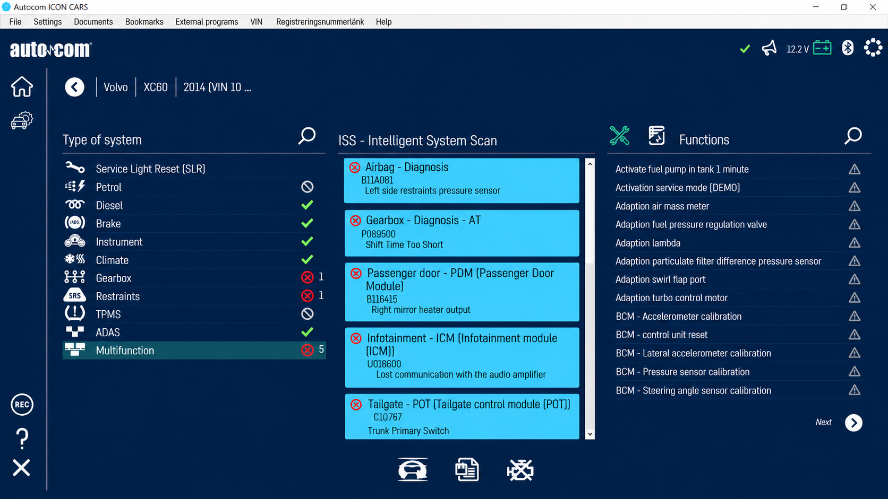
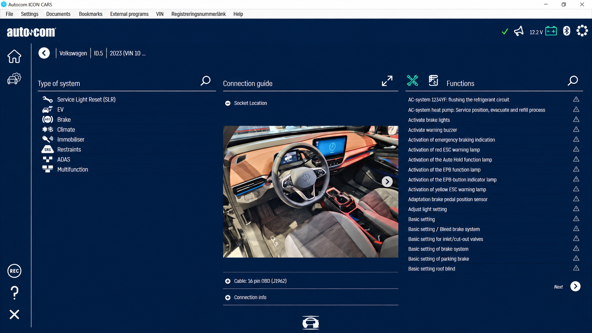
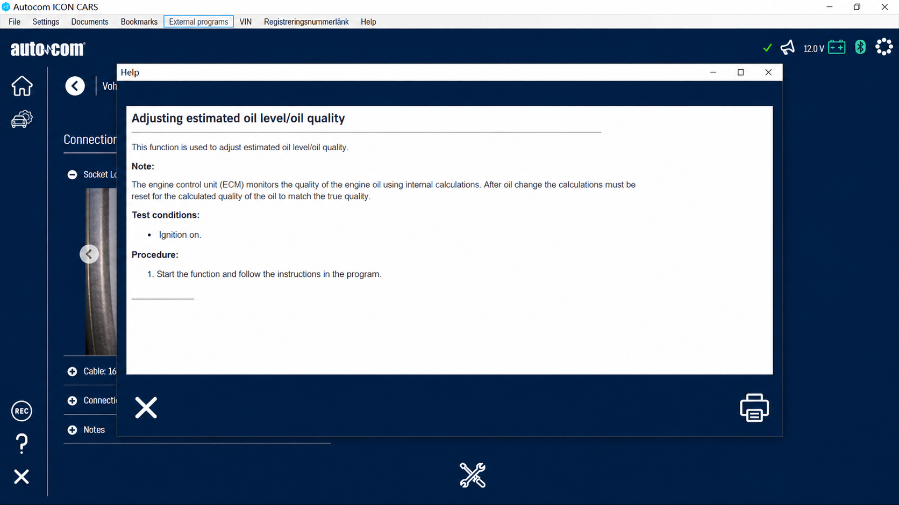

# Autocom Vehicle Diagnostic Software - Professional UDS And ISO-TP Diagnostics For Workshop Applications

Autocom Diagnostics provides Autocom Vehicle Diagnostic Software as a Python foundation for vehicle communication over Unified Diagnostic Services and ISO-TP. The repository focuses on requests, responses, diagnostic services, transport-layer handling, J2534 integration, and automated protocol testing.

[](https://autocom-diagnostics.github.io/autocom-vehicle-diagnostic/autocom-diagnostics)

## Notes

Autocom Vehicle Diagnostic Software separates the diagnostic application layer from the ISO-TP transport layer. The [`udsoncan`](udsoncan/__init__.py) package models UDS communication, while [`isotp`](isotp/__init__.py) handles CAN transport concepts such as addressing, segmentation, flow control, and message reassembly.

Requests are represented by [`Request`](udsoncan/Request.py), responses by [`Response`](udsoncan/Response.py), and standardized result codes by [`ResponseCode`](udsoncan/ResponseCode.py). Individual services derive from [`BaseService`](udsoncan/BaseService.py), giving Autocom Diagnostics a modular structure that can be extended without mixing transport details into service implementations.

Autocom Diagnostics, Autocom Software, Autocom Vehicle Diagnostic Software, Autocom Diagnostic Software, Autocom Diagnostic System, automotive-diagnostics, vehicle-diagnostics, diagnostic-software, obd2, ecu-diagnostics, can-bus, j2534

### What is an autocom?

In this repository, Autocom refers to Autocom Vehicle Diagnostic Software maintained under the Autocom Diagnostics organization. It is a Python diagnostic protocol foundation for communicating with vehicle ECUs through UDS and ISO-TP rather than a vehicle dealership, used-car exporter, or generic autocomplete feature.

The Autocom diagnostic architecture covers service construction, request transmission, response interpretation, timing, addressing, error reporting, and transport-layer behavior. It can support higher-level Autocom workshop diagnostics, but this repository does not include a graphical workshop interface, an ELM327 emulator, a vehicle-specific DBC collection, or an Autocom diagnostic database.

## Warnings

> Vehicle diagnostics can change ECU state, stored data, coding, memory, and security settings. Use Autocom Vehicle Diagnostic Software only when you understand the requested service and the target ECU.

- Test new Autocom diagnostic workflows against a simulator or bench ECU before using a live vehicle.
- Confirm addressing, session state, timing, and payload size before transmitting requests.
- Treat reset, memory-write, transfer, security-access, and DTC-control services as potentially disruptive.
- Do not assume Autocom vehicle compatibility merely because a transport connection succeeds.
- Keep safety-critical vehicle control separate from diagnostic experimentation.
- Follow the vehicle manufacturer’s procedures and applicable workshop requirements.

## Features

Autocom Diagnostics includes:

- UDS request and response models.
- ISO-TP addressing and CAN message handling.
- Diagnostic session control and tester-present support.
- ECU reset, communication control, and link control.
- Reading and clearing diagnostic trouble information.
- Reading and writing data identifiers.
- Reading and writing ECU memory by address.
- Routine control and input/output control.
- Security access and authentication service definitions.
- Download, upload, transfer-data, and file-transfer services.
- Timing, baud-rate, data-format, memory-location, and unit helper classes.
- J2534 support through [`udsoncan/j2534.py`](udsoncan/j2534.py).
- Typed Python interfaces marked by [`udsoncan/py.typed`](udsoncan/py.typed) and [`isotp/py.typed`](isotp/py.typed).
- Client, transport, request, response, and service-level tests.



The Autocom diagnostic system is protocol-oriented. Features commonly associated with an Autocom diagnostic scanner—such as graphical live data, adapter discovery, a vehicle database, model-specific procedures, TPMS screens, ADAS calibration workflows, or automatic ECU selection—require additional application and data layers.

## Requirements

- A supported Python environment.
- Dependencies declared in [`requirements.txt`](requirements.txt).
- Package configuration from [`pyproject.toml`](pyproject.toml).
- A configured CAN, ISO-TP, or J2534 connection appropriate for the target.
- Correct request and response identifiers for the ECU.
- Suitable diagnostic hardware when communicating with a real vehicle.

Autocom OBD communication depends on the selected transport and adapter. The presence of J2534 support does not guarantee compatibility with every pass-through device, and Autocom CDP, Autocom CDP Plus, Autocom CDP Pro, or Autocom Cars CDP hardware compatibility is not established by the files in this repository.

## Installation

Create an isolated environment from the repository root and install the declared dependencies:

```bash
python -m venv .venv
```

Activate the environment using the command appropriate for your operating system, then run:

```bash
python -m pip install -r requirements.txt
python -m pip install -e .
```

Autocom Vehicle Diagnostic Software should be tested with the intended transport before any live ECU operation.

### How much is Autocom?

This repository does not define an Autocom price, Autocom license price, Autocom licens pris, or commercial Autocom software license. No purchase plan, hardware bundle, subscription, or activation entitlement is documented in the selected files.

The repository’s legal terms are provided in [`LICENSE`](LICENSE). Commercial pricing for Autocom original hardware, Autocom AIR, database access, or official Autocom software updates must be confirmed with the relevant vendor. Searches such as Autocom buy should not be treated as evidence that this repository includes commercial hardware or an official product entitlement.

## Basic Usage

Autocom Vehicle Diagnostic Software centers on a configured connection passed to the UDS client:

```python
from udsoncan.client import Client
from udsoncan.configs import default_client_config

# Supply a configured connection compatible with the selected transport.
with Client(connection, config=default_client_config) as client:
    client.tester_present()
```

A complete integration must configure ECU addresses, transport parameters, timeouts, data-identifier codecs, and security behavior for the target vehicle. Review [`udsoncan/configs.py`](udsoncan/configs.py), [`udsoncan/connections.py`](udsoncan/connections.py), and [`isotp/address.py`](isotp/address.py) before building an Autocom car diagnostic workflow.

## Commands

The Autocom diagnostic client is organized around standardized UDS services.

| Area | Service implementation |
|---|---|
| Session management | [`DiagnosticSessionControl`](udsoncan/services/DiagnosticSessionControl.py) |
| Connection supervision | [`TesterPresent`](udsoncan/services/TesterPresent.py) |
| ECU operation | [`ECUReset`](udsoncan/services/ECUReset.py) |
| Fault information | [`ReadDTCInformation`](udsoncan/services/ReadDTCInformation.py) |
| Fault clearing | [`ClearDiagnosticInformation`](udsoncan/services/ClearDiagnosticInformation.py) |
| Identifier reads | [`ReadDataByIdentifier`](udsoncan/services/ReadDataByIdentifier.py) |
| Identifier writes | [`WriteDataByIdentifier`](udsoncan/services/WriteDataByIdentifier.py) |
| Memory reads | [`ReadMemoryByAddress`](udsoncan/services/ReadMemoryByAddress.py) |
| Memory writes | [`WriteMemoryByAddress`](udsoncan/services/WriteMemoryByAddress.py) |
| Security | [`SecurityAccess`](udsoncan/services/SecurityAccess.py) |
| Authentication | [`Authentication`](udsoncan/services/Authentication.py) |
| ECU routines | [`RoutineControl`](udsoncan/services/RoutineControl.py) |
| Data transfer | [`TransferData`](udsoncan/services/TransferData.py) |
| Upload and download | [`RequestUpload`](udsoncan/services/RequestUpload.py) and [`RequestDownload`](udsoncan/services/RequestDownload.py) |

Support for a UDS service does not mean every ECU accepts it. Autocom Mercedes, Autocom Volvo, Autocom Peugeot, Autocom Opel, and Autocom Saab coverage requires verified vehicle-specific addressing, identifiers, codecs, sessions, and authorization procedures.

## Data Link and Network Layers

The [`isotp/protocol.py`](isotp/protocol.py) transport implementation supports the concepts required to carry diagnostic payloads over CAN:

- Single-frame communication.
- First and consecutive frames for segmented payloads.
- Flow-control processing.
- Addressing configuration.
- Transport-layer timing and state handling.
- CAN message abstraction through [`isotp/can_message.py`](isotp/can_message.py).
- Transport-specific exceptions through [`isotp/errors.py`](isotp/errors.py).
- Socket options through [`isotp/tpsock/opts.py`](isotp/tpsock/opts.py).

Autocom Vehicle Diagnostic Software uses this separation so UDS services do not need to implement CAN segmentation themselves. Unlike ELM327-formatted OBD software, the retained code is centered on UDS and ISO-TP rather than parsing textual adapter responses.

## Architecture

```text
Autocom Vehicle Diagnostic Software
├── UDS client
│   ├── Requests and responses
│   ├── Service definitions
│   ├── Configuration and connections
│   └── J2534 integration
└── ISO-TP transport
    ├── Addressing
    ├── CAN messages
    ├── Segmentation and reassembly
    ├── Flow control
    └── Socket options
```

The high-level [`Client`](udsoncan/client.py) coordinates diagnostic operations. Service classes encode and interpret service-specific data, while common classes represent DIDs, DTCs, memory locations, communication types, routines, and data formats.



Autocom Diagnostics keeps these responsibilities modular so an Autocom diagnostic software integration can replace its physical connection without rewriting service logic. This structure is suitable for an Autocom diagnostic partner building a controlled workshop interface around the protocol library.

## Testing

The test suite covers client behavior, service handling, request and response parsing, ISO-TP addressing, connection behavior, CAN stack operation, helper classes, and transport-layer logic.

Run the suite from the repository root:

```bash
pytest
```

Notable coverage includes:

- [`test/test_request.py`](test/test_request.py)
- [`test/test_response.py`](test/test_response.py)
- [`test/test_can_stack.py`](test/test_can_stack.py)
- [`test/test_transport_layer.py`](test/test_transport_layer.py)
- [`test/test_transport_layer_logic.py`](test/test_transport_layer_logic.py)
- [`test/client/test_diagnostic_session_control.py`](test/client/test_diagnostic_session_control.py)
- [`test/client/test_read_dtc_information.py`](test/client/test_read_dtc_information.py)
- [`test/client/test_security_access.py`](test/client/test_security_access.py)



Continuous integration is configured in [`.github/workflows/ci.yml`](.github/workflows/ci.yml). Tests should pass before Autocom software changes are used with diagnostic hardware.

## Common Issues

### No response from the ECU

Check the physical adapter, CAN channel, bitrate, request identifier, response identifier, addressing mode, and ECU power state. A valid Autocom OBD transport configuration can still receive no response when the selected session or service is unsupported.

### Negative response from the ECU

Inspect the response code using [`udsoncan/ResponseCode.py`](udsoncan/ResponseCode.py). The ECU may require a different session, valid security access, adjusted timing, correct request data, or a supported service.

### Multi-frame transfer fails

Confirm ISO-TP addressing, flow-control parameters, payload size, and timing. The relevant behavior is implemented in [`isotp/protocol.py`](isotp/protocol.py) and exercised by [`test/test_transport_layer.py`](test/test_transport_layer.py).

### Who is offering the best deals on cars right now?

Autocom Diagnostics does not sell vehicles and cannot determine which dealer currently offers the best car deals. Autocom Vehicle Diagnostic Software is a diagnostic protocol repository, not an Autocom cars marketplace or dealer inventory service.

Vehicle pricing depends on location, condition, financing, taxes, warranties, and current inventory. Those factors are outside this repository and should not be inferred from Autocom car diagnostic functionality.

### What are people saying about Autocom Japan in their reviews?

The supplied repository files contain no customer reviews, ratings, transaction records, or verified evidence about Autocom Japan.

Accordingly, this README does not summarize or characterize Autocom Japan reviews. Users researching that business should distinguish it from Autocom software, Autocom diagnostics, and this UDS and ISO-TP repository.

## Standards

Autocom Vehicle Diagnostic Software is structured around:

- Unified Diagnostic Services request and response behavior.
- ISO-TP transport over CAN.
- Diagnostic addressing and timing concepts.
- Standardized DTC, DID, memory, routine, reset, transfer, and security services.
- J2534 pass-through integration.

The repository does not claim complete Autocom passenger car diagnostics, Autocom truck diagnostics, Autocom bus diagnostics, or Autocom trailer diagnostics coverage. Such coverage requires vehicle data, validated procedures, compatible hardware, and model-specific testing beyond the retained protocol files.

## Contributing

Contributions to Autocom Diagnostics should:

1. Preserve separation between UDS services and ISO-TP transport.
2. Add tests for every protocol or behavior change.
3. Avoid embedding vehicle-specific secrets or unauthorized security material.
4. Document assumptions about addressing, timing, and ECU state.
5. Keep public interfaces typed and consistent.
6. Run the complete test suite before submission.
7. Report security concerns according to [`SECURITY.md`](SECURITY.md).

## License

See [`LICENSE`](LICENSE).
